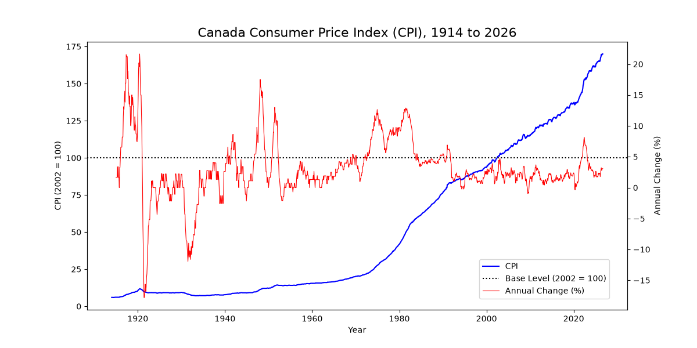

# FINE3300-2026-A2
FINE 3300 Assignment 2 – Python inflation calculator using Bank of Canada CPI data, with pandas and matplotlib.

## Introduction
The Consumer Price Index (CPI) measures how the cost of a basket of everyday goods and services
(like food, rent, clothing, and transportation) changes over time. Statistics Canada tracks it
every month, and the Bank of Canada uses it to measure inflation. For this project, I recreated
the Bank of Canada's Inflation Calculator in Python using pandas and matplotlib. The Bank's
calculator only lets you pick a year, so I improved it to take both a month and a year, since
the data is monthly.

## Files
- `inflation_calculator.ipynb` – Jupyter notebook that loads the CPI data, creates the graph, and runs the inflation calculator
- `STATIC_INFLATIONCALC.csv` – Monthly CPI data from the Bank of Canada (January 1914 to September 2026)
- `cpi_graph.png` – Graph of the CPI and its annual percentage change
- `README.md` – This write-up

## How to Run
1. Install the required libraries: `pip install pandas matplotlib`
2. Download or clone this repository
3. Open `inflation_calculator.ipynb` in VS Code or Jupyter
4. Click Run All
5. When prompted, enter the price (e.g. `1000`), the first date (e.g. `2002-07`), and the second date (e.g. `2026-09`)

The program checks each input and asks again if something is invalid.

## Data Notes
- Source: Bank of Canada Inflation Calculator, based on Statistics Canada series V41690973
- Base level: 2002 = 100
- The first 8 lines of the file are extra information, so they are skipped
- Two extra rows dated 1927-04-30 and 1932-04-30 were removed because every other row is dated on the 1st of the month and these repeated the May value

## CPI Graph


The blue line shows the CPI and the red line shows the annual percentage change (right axis).
The dotted line is the base level, where 2002 = 100. Overall, prices went up about 28 times
since 1914. Something that cost $1 in 1914 would cost about $28 today.

## Sample Output
Using $1000, first date as 2002-07 and second date as 2026-09
```
----------------------------------------------------------------------------------------------------
Inflation Calculator Results
----------------------------------------------------------------------------------------------------
$1,000.00 CAD in July 2002 would cost $1,691.54 CAD in September 2026
Percent change: 69.15%
Number of years: 24.17
Average annual rate of inflation: 2.20%
CPI for first date (July 2002): 100.5
CPI for second date (September 2026): 170.0
----------------------------------------------------------------------------------------------------
```

## A few things stood out to me:

- After World War I, inflation hit its highest point in the data at 21.6% in June 1920, then
  prices crashed by 17.8% a year later. Prices also fell during the Great Depression
  (about -12% in 1931).
- After World War II, inflation jumped to 17.5% in early 1948.
- The 1970s and early 1980s had a long stretch of high inflation, peaking at 12.9% in 1981.
  You can also see the CPI line start to climb much faster from this point on.
- There is a small spike in January 1991, which is when the GST was introduced.
- From about 1992 to 2020, inflation was very steady, averaging about 1.8% a year. This is
  around when the Bank of Canada started targeting 2% inflation.
- After COVID, inflation jumped to 8.1% in June 2022, the highest in about 40 years,
  before coming back down to around 3%.